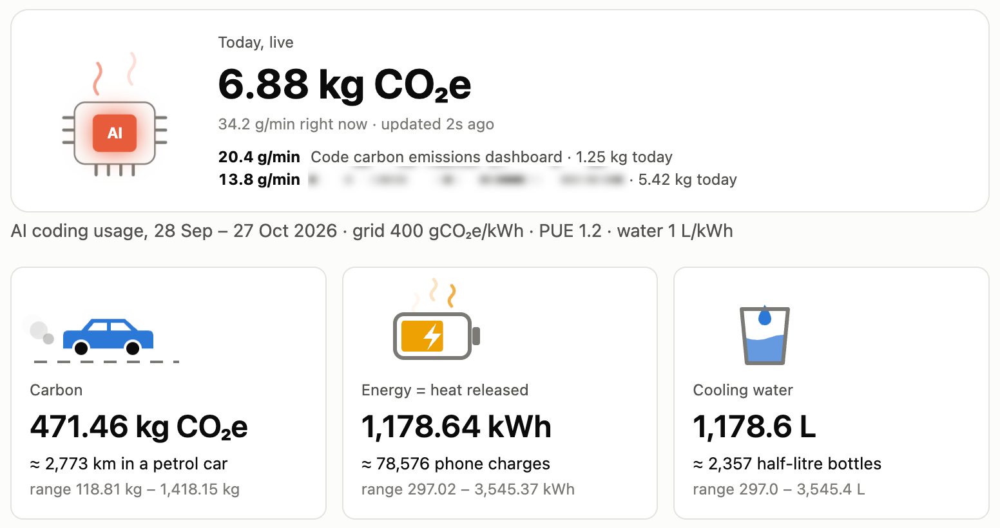

# TokenToll: the carbon footprint of your AI coding

> **POV: you vibe-coded all month and your AI was lowkey on a 2,740 km road trip 🚗💨**
>
> No cap, every prompt has a carbon footprint. TokenToll spills the tea:
> CO₂, heat and water, live, on your own machine. It's giving main-character
> energy, but make it accountable. 🌱✨ Touch grass, then check your number. 💀



*The live dashboard (`carbon.py --live`). In the real thing the chip glows, the car drives, the battery charges and the water ripples.*

## Your AI pair programmer runs on electricity. Now you can see how much.

Every prompt you send lights up a GPU in a data centre somewhere. It draws
power, gives off heat, and uses water to stay cool. **TokenToll** turns your
AI coding (Claude Code, Codex, Gemini CLI, or any AI API) into numbers you can feel:

> 🚗 **km driven** · 🔋 **phone charges** · 💧 **bottles of cooling water**

Here's one real month of heavy Claude Code use (the author's own, 30 days):

| | |
|---|---|
| **CO₂e** | **≈ 466 kg**, about **2,740 km in a petrol car** |
| **Energy (all of it ends up as heat)** | **≈ 1,165 kWh**, about **77,700 phone charges** |
| **Cooling water** | **≈ 1,165 L**, about **2,330 half-litre bottles** |
| **The surprise** | **~80%** came from the AI *re-reading* context it had already seen (27 billion cached tokens), not from writing code |

*Central estimates. The honest range is about 4× either way; see [Method](#method).*

### Why you'll want it

- **👀 See it live.** An animated AI chip heats from blue to red while your
  sessions run, and a counter ticks up as you code.
- **🤝 Works with the big players.** Claude Code, Codex and Gemini CLI automatically; OpenAI, Anthropic, Gemini, Bedrock, Groq and other APIs [with one line of logging](#log-any-ai-api).
- **🧾 Every session, by name.** Find which task, project or model cost the most.
- **💬 Right above your chat.** A one-line band shows this session's footprint
  after every turn.
- **🔒 Nothing leaves your machine.** It reads your AI tools' local logs, makes
  no outbound network calls, and needs no account, no API key and no
  `pip install`: one Python file.
- **📚 Sources, not vibes.** Every rate is based on published research (Epoch AI,
  Google) or labelled as an assumption you can change.
- **✂️ Shows you how to cut it.** [Six habits](#pay-less-toll-how-to-cut-your-footprint-) that shrink the number, biggest first.
- **🆓 Open source, MIT.**

### Share your number

Run it, then post your own month:

> My AI coding last month: **≈ ___ kg CO₂e**, the same as driving ___ km. ___% of it was
> the AI re-reading context. Measure yours: TokenToll 🌱 github.com/codeandqa/tokentoll

Or the unhinged version:

> not me finding out my AI pair programmer drove ___ km last month 💀 ___% of it was just
> re-reading my code. the audacity. TokenToll, check yours bestie 🌱 github.com/codeandqa/tokentoll

---

## Pay less toll: how to cut your footprint 🌱

Knowing the number is step one. Here's how to make it smaller.

### Why it's high: the AI re-reads everything, every turn

On each turn, Claude re-reads the whole conversation so far. A session holding
300,000 tokens of context re-reads all of them on every one of its next 100
turns. So your footprint grows with **context size × number of turns**, not
with how much code you write.

In the example month above, **4 long sessions made about 98% of the total**,
and **about 80%** was the AI re-reading context it had already seen.

### What to change, biggest effect first

1. **Keep sessions short and focused.**
   - Start a new session, or run `/clear`, when you move to an unrelated task.
   - A fresh session with a short handoff note re-reads far less than one
     that has carried the whole day's history.
   - If a session must keep going, `/compact` shrinks what gets re-read.
2. **Use fewer agents at once, with narrow briefs.** Every subagent or
   agent-team member re-reads its own context every turn, so five agents in
   parallel cost about five times as much. Give each one a tight task, not
   the whole history.
3. **Use a smaller model for routine work** (`/model`). In TokenToll's rates,
   Haiku counts about 0.33× and Opus 1.7× per token, so Haiku comes out
   roughly 5× cheaper. Search, summaries, simple edits and subagents rarely
   need the biggest model.
4. **Trim what loads on every turn.** Memory files, long `CLAUDE.md` files,
   and the tool lists from connected plugins and MCP servers are sent with
   every request. Archive stale memory and turn off connections you don't use.
5. **Batch your asks.**
   - One message with three requests costs one re-read; three messages cost three.
   - Avoid tight polling such as `/loop` every minute: each wake-up re-reads
     the context.
6. **Ask for less output.** "Show me the diff," not "rewrite the file."
   Output tokens cost about 3× input in TokenToll's rates.

### How to tell it's working

- **Live:** keep the band visible. "This session" should stay in the hundreds
  of grams, not climb into kilograms.
- **Over time:** in the dashboard's **By session** table, your heaviest sessions
  should shrink, and the daily chart should lose its big spikes.

> **Cut first, offset later.** Anthropic doesn't let you choose which data
> centre or power grid serves your requests, so these habits are the levers
> you actually control. Carbon offsets are a weaker fallback, not a substitute.

## Works with

| Platform | How TokenToll reads it | How well it's tested |
|---|---|---|
| **Claude Code** (Anthropic) | Automatic: `~/.claude/projects` | On real logs |
| **Codex** CLI and IDE extension (OpenAI) | Automatic: `~/.codex/sessions` | On real logs: matches Codex's own session totals within 0.05% |
| **Gemini CLI** (Google) | Automatic: `~/.gemini/tmp/<project>/chats/*.jsonl` | Built from Gemini CLI's source code and tested on sample files, not yet on real logs. Sessions from old versions, saved as single `.json` files, aren't read |
| **APIs:** OpenAI, Anthropic, Google Gemini, AWS Bedrock, Ollama, and OpenAI-compatible APIs such as Groq, Mistral, xAI, DeepSeek, OpenRouter and Together | Your app appends each response's `usage` to `~/.tokentoll/usage.jsonl` ([how](#log-any-ai-api)) | Each provider's usage format is tested with sample objects; not run against the live APIs |

**Not covered:**
- **Cursor:** its local database records which lines the AI wrote, not token counts.
- **Web and mobile chat apps** (ChatGPT, Claude.ai, Gemini): they keep usage on the vendor's servers.
- **GitHub Copilot and Windsurf:** not checked yet.
- **OpenCode and Aider:** not read automatically yet (OpenCode's storage format is still changing). If you call a model API yourself, the usage file works.

**Hardware caveat:** the energy rates come from studies of GPUs in data
centres. Groq runs its own LPU chips, and Ollama runs on your own computer, so
their real energy per token may differ from these estimates.

---

## What it is

**TokenToll** estimates how much energy, CO₂, heat and cooling water your AI
coding costs, using the token counts your tools already write to disk (see
[Works with](#works-with)). It has three parts:

| Part | What it does |
|---|---|
| **Skill** (`/tokentoll`) | Ask "how green is my coding?" and Claude runs the estimator and explains the result. |
| **Dashboard** | An HTML page with animated tiles, a daily chart, and breakdowns by session, project, model and tool. It can run live, updating every 5 seconds while you work. |
| **Chat band** (optional) | A strip above the Claude Code prompt, framed and titled **TokenToll**, with this session's and today's totals, plus **Dashboard**, **Carbon audit** and **Close** buttons. |

> **These are estimates, not measurements.** The token counts are exact; they
> come from your own logs. The energy each token uses is not published by
> Anthropic, so the tool converts tokens to energy with rates based on public
> research (see [Method](#method)). Every figure is shown with a low–high
> range of roughly 4× either side. Read it as an order of magnitude.

---

## What you see

**Dashboard** (`carbon.py`, or `carbon.py --live`):

- **Three animated tiles**, each with its everyday equivalent:
  - **Carbon**, in g/kg CO₂e: a car driving, with "≈ N km in a petrol car".
  - **Energy = heat released**, in kWh: a phone battery charging, with "≈ N phone charges".
  - **Cooling water**, in litres: a drop falling into a glass, with "≈ N half-litre bottles".
- **Daily CO₂e** as a bar chart, one bar per day. Hovering or keyboard focus shows a day's value, and a table view lists every day.
- **By session**, **By project** and **By model** tables with tokens, CO₂e and share. Each table shows the top 10 rows and folds the rest into "Other (N)".
  - Sessions are listed by their full name: your rename if you gave one, otherwise Claude Code's AI title, otherwise the last prompt (cut to 120 characters). The project folder and short session ID sit underneath.
- **Live mode only:** an AI chip that heats from blue to orange to red as the last 5 minutes' rate climbs toward 50 g CO₂e per minute. Heat waves rise off it, a counter of today's CO₂e ticks up, and every session active in the last 5 minutes is listed with its own rate and marked **● live**.
- **Light and dark themes.** With "reduce motion" on, the animations stop.

**Chat band:**

```
╭──────────────────────────────────────────────────────────────────────────────────────────────────────────────────╮
│ ● TokenToll  this session 483 g   1.21 kWh heat   1.2 L water   today 3.11 kg   Dashboard   Carbon audit   Close │
╰──────────────────────────────────────────────────────────────────────────────────────────────────────────────────╯
```

- **Dashboard** starts the live dashboard and opens it in your browser.
- **Carbon audit** asks Claude, as a normal prompt, to run the TokenToll skill: your footprint, the heaviest sessions and projects, and how to cut them.
- **Close** hides the band, and stays hidden in new sessions. Type `/tokentoll-band` to show it again (`/tokentoll-band show` and `/tokentoll-band hide` also work).
- **If the script can't run** (not installed at the path below, or no `python3`), the band shows the reason in place of the numbers.

---

## Requirements

- **At least one supported tool or API** from [Works with](#works-with).
- **Python 3**, standard library only (no `pip install`). Tested with Python 3.14 on macOS.
- **The band only:** a Claude Code build with hooks modules ("mods"). That API is marked early access and may change between releases.

---

## Install

Clone the repo into your Claude Code skills folder. The folder must be named
`tokentoll`, because the band looks for the script at this path:

```bash
git clone https://github.com/codeandqa/tokentoll.git ~/.claude/skills/tokentoll
```

That gives you:

```
~/.claude/skills/tokentoll/
├── SKILL.md            # tells Claude when and how to use the tool
├── carbon.py           # the estimator, dashboard and live server
├── test_carbon.py      # unit tests
├── evals/              # behaviour evals for the skill (claude plugin eval)
├── README.md
├── LICENSE
└── tokentoll-band/     # the optional chat band (folder name = plugin name)
    ├── .claude-plugin/plugin.json
    ├── hooks/hooks.json
    ├── hooks/register.tsx   # the band
    ├── hooks/band.test.tsx  # its tests
    └── types/index.d.ts     # the state it keeps
```

Claude Code picks up skills from `~/.claude/skills/`, so `/tokentoll` is
available in your next session.

**The chat band (optional).** Start Claude Code with the band folder:

```bash
claude --plugin-dir ~/.claude/skills/tokentoll/tokentoll-band
```

or list that folder in the `CLAUDE_CODE_PLUGIN_DIRS` environment variable.

**Update** with `git -C ~/.claude/skills/tokentoll pull`.

**Not using Claude Code?** Clone the repo anywhere and run `python3 carbon.py`.
The `/tokentoll` skill and the chat band are Claude Code features; the report,
the live dashboard and every data source work without them.

---

## Usage

**Ask Claude:**
- "How green is my coding?"
- "What's my AI carbon footprint this month?"
- `/tokentoll`

**Or run it yourself:**

```bash
# 30-day report written to ~/.claude/tokentoll-report.html
python3 ~/.claude/skills/tokentoll/carbon.py

# Live dashboard at http://127.0.0.1:8765/ (Ctrl+C to stop)
python3 ~/.claude/skills/tokentoll/carbon.py --live

# Today's totals and one session's totals, as JSON (what the band uses)
python3 ~/.claude/skills/tokentoll/carbon.py --json --session <session-id>
```

| Flag | Default | Meaning |
|---|---|---|
| `--days N` | `30` | How many days back to include (1 or more) |
| `--grid G` | `400` | Grid carbon intensity, gCO₂e per kWh (see [Assumptions](#assumptions-you-can-change)) |
| `--wue L` | `1.0` | Litres of cooling water per kWh (`--grid` and `--wue` can't be negative) |
| `--out PATH` | `~/.claude/tokentoll-report.html` | Where the static report is written |
| `--live` | off | Serve a live dashboard instead of writing a file |
| `--port P` | `8765` | Port for `--live`. If it's taken, the script says so and exits |
| `--json` | off | Print `{"today": …, "session": …}` and exit |
| `--session ID` | none | With `--json`: the session to total |
| `--root PATH` | `~/.claude/projects` | Where the Claude Code logs are |
| `--codex-root PATH` | `~/.codex/sessions` | Where the Codex logs are |
| `--gemini-root PATH` | `~/.gemini/tmp` | Where the Gemini CLI logs are |
| `--usage-file PATH` | `~/.tokentoll/usage.jsonl` | The file your apps append API usage to |

The JSON looks like this. `g` is grams CO₂e, `kwh` is energy (= heat) and `water_l` is litres; all are central estimates:

```json
{"today": {"g": 3105.05, "kwh": 7.7626, "water_l": 7.763},
 "session": {"g": 482.81, "kwh": 1.207, "water_l": 1.207, "tokens": 23889066}}
```

### Log any AI API

APIs keep no logs on your computer, so have your app add one line per call to
`~/.tokentoll/usage.jsonl`. Pass the provider's `usage` object exactly as the
API returns it; TokenToll reads each provider's own field names.

```python
import json
from datetime import datetime, timezone
from pathlib import Path

LOG = Path.home() / ".tokentoll" / "usage.jsonl"

def log_usage(tool, model, usage):
    """Append one API call's usage to TokenToll's usage file."""
    if hasattr(usage, "model_dump"):  # SDK objects (OpenAI, Anthropic, Groq, google-genai, ...)
        usage = usage.model_dump()
    LOG.parent.mkdir(exist_ok=True)
    with LOG.open("a") as f:
        f.write(json.dumps({"ts": datetime.now(timezone.utc).isoformat(),
                            "tool": tool, "model": model, "usage": usage}) + "\n")
```

Then call it after each request:

```python
# OpenAI, or OpenAI-compatible SDKs: Groq, Mistral, xAI, DeepSeek, OpenRouter, Together
r = client.chat.completions.create(model=MODEL, messages=messages)
log_usage("groq", r.model, r.usage)

# Anthropic
r = client.messages.create(model=MODEL, max_tokens=1024, messages=messages)
log_usage("anthropic", r.model, r.usage)

# Google Gemini (google-genai)
r = client.models.generate_content(model=MODEL, contents=prompt)
log_usage("gemini", MODEL, r.usage_metadata)

# AWS Bedrock (boto3 Converse)
r = bedrock.converse(modelId=MODEL, messages=messages)
log_usage("bedrock", MODEL, r["usage"])

# Ollama
r = ollama.chat(model=MODEL, messages=messages)
log_usage("ollama", MODEL, {"prompt_eval_count": r.prompt_eval_count, "eval_count": r.eval_count})
```

- **Fields:** each line needs `ts`. `tool`, `model`, `session` and `project`
  are optional and appear in the dashboard's tables.
- **Other languages:** write the same JSON line yourself.
- **Testing:** these snippets haven't been run against the live APIs; the
  field handling is tested with sample usage objects.

---

## Method

The calculation follows the shape of the Green Software Foundation's
[Software Carbon Intensity (SCI)](https://greensoftware.foundation/standards/sci/)
specification, published as ISO/IEC 21031:2024: carbon = energy × grid
intensity. It leaves out SCI's embodied-hardware term.

### 1. Tokens: read from your logs (exact)

For every API response a tool logged, the script sorts the tokens into three
kinds. For Claude Code, from `message.usage`:

| Kind | Fields in the log |
|---|---|
| Output | `output_tokens` (includes thinking tokens) |
| Fresh input | `input_tokens` + `cache_creation_input_tokens` |
| Cache read | `cache_read_input_tokens` |

Claude Code writes the same response on several lines, and resumed sessions
copy earlier history. Each response is therefore counted once, keyed by
`message.id` + `requestId`. Subagent logs are included.

The other sources map onto the same three kinds:

- **Codex** logs a running total per session, so each update counts what the
  total grew by. Its `input_tokens` include `cached_input_tokens`, and its
  `output_tokens` include reasoning tokens.
- **Gemini CLI** records `tokens` on each reply and may write a reply twice,
  so each message ID counts once. Its `input` includes `cached`, `thoughts`
  count as output, and `tool` counts as fresh input.
- **API usage objects** are read in each provider's own format:

| Provider | Fresh input | Cache read | Output |
|---|---|---|---|
| Anthropic | `input_tokens` + `cache_creation_input_tokens` | `cache_read_input_tokens` | `output_tokens` |
| OpenAI chat and OpenAI-compatible APIs | `prompt_tokens` − cached | `prompt_tokens_details.cached_tokens` | `completion_tokens` |
| OpenAI Responses | `input_tokens` − cached | `input_tokens_details.cached_tokens` | `output_tokens` |
| Google Gemini | `promptTokenCount` − cached | `cachedContentTokenCount` | `candidatesTokenCount` + `thoughtsTokenCount` |
| AWS Bedrock Converse | `inputTokens` + `cacheWriteInputTokens` | `cacheReadInputTokens` | `outputTokens` |
| Ollama | `prompt_eval_count` | none | `eval_count` |

### 2. Energy per token (estimated)

Watt-hours per 1,000 tokens for a Sonnet-class model:

| Token kind | Low | **Central** | High |
|---|---|---|---|
| Output | 0.2 | **0.6** | 2.0 |
| Fresh input and cache writes | 0.05 | **0.2** | 0.6 |
| Cache read | 0.005 | **0.02** | 0.06 |

Where the central figures come from:

- **Output, 0.6 Wh per 1k.** Epoch AI estimates a typical GPT-4o query at
  about 0.3 Wh, assuming 500 output tokens
  ([Epoch AI, 7 Feb 2025](https://epoch.ai/gradient-updates/how-much-energy-does-chatgpt-use)).
- **Fresh input, 0.2 Wh per 1k.** The same article estimates about 2.4–2.5 Wh
  for a query with 10,000 input tokens, which is roughly 0.2 Wh per 1k input
  tokens above the base query.
- **Cache read, 0.02 Wh per 1k.** An assumption: 10% of a fresh input token,
  the same ratio as Anthropic's list price for cached input. No provider
  publishes this figure.
- **Cross-check.** Google reports 0.24 Wh, 0.03 gCO₂e and 0.26 mL of water for
  the median Gemini Apps text prompt, counting idle capacity, CPU/RAM and
  data-centre overhead. Counting active accelerators only, it reports 0.10 Wh
  ([Google Cloud blog, 21 Aug 2025](https://cloud.google.com/blog/products/infrastructure/measuring-the-environmental-impact-of-ai-inference)).
  These are Google's own measurements and have not been independently
  verified.

Two adjustments then apply:

- **Model size**, taken from relative list price because no model sizes are
  published: Haiku × 0.33, Sonnet × 1.0, Opus and Fable × 1.7. Other
  vendors' models whose names mark a small tier (`mini`, `nano`, `flash`,
  `lite`, `small`) count × 0.33; any other model × 1.0. These are assumptions,
  not measurements.
- **Data-centre overhead (PUE)** × 1.2, for cooling and power conversion.
  Google reports a fleet-wide PUE of 1.09 in the post above, so 1.2 leans
  conservative.

### 3. Carbon, heat and water (arithmetic)

| Result | Formula |
|---|---|
| CO₂e | kWh × grid intensity (default 400 gCO₂e/kWh) |
| Heat | ≈ kWh. Almost all electricity a data centre draws ends up as heat |
| Water | kWh × water use per kWh (default 1.0 L/kWh; Google's figures above work out to about 1.08) |
| Car km | CO₂e ÷ 170 g/km |
| Phone charges | Wh ÷ 15 Wh |
| Bottles | litres ÷ 0.5 |

### Worked example: one real response (Opus)

| Step | Calculation | Result |
|---|---|---|
| Output | 2,961 tokens × 0.6 Wh/1k | 1.78 Wh |
| Fresh input | 45,047 tokens × 0.2 Wh/1k | 9.01 Wh |
| Cache read | 44,766 tokens × 0.02 Wh/1k | 0.90 Wh |
| Subtotal | | 11.68 Wh |
| × Opus 1.7 × PUE 1.2 | | **23.8 Wh** |
| × 400 g/kWh | | **≈ 9.5 g CO₂e** |

---

## Assumptions you can change

Every constant sits near the top of `carbon.py`:

| Constant | Value | Status |
|---|---|---|
| `WH_PER_1K` | see the table above | Output and input are based on Epoch AI; cache read is an assumption |
| `MODEL_SCALE` | Haiku 0.33, Sonnet 1, Opus/Fable 1.7 | Assumption, from list price |
| `PUE` | 1.2 | Assumption, conservative next to Google's reported 1.09 |
| `--grid` | 400 gCO₂e/kWh | Assumption. The 2023 world average was about 481 g/kWh ([Our World in Data / Ember](https://ourworldindata.org/grapher/carbon-intensity-electricity)). Anthropic doesn't say which data centres or grids served a request, so set your own figure if you know better |
| `--wue` | 1.0 L/kWh | Assumption, close to Google's implied 1.08 |
| `CAR_G_PER_KM` | 170 | Rough assumption for a petrol car, used only for the comparison |
| `PHONE_CHARGE_WH` | 15 | Rough assumption, used only for the comparison |
| `LIVE_WINDOW_S` | 300 | The "right now" rate covers the last 5 minutes |
| `HOT_G_PER_MIN` | 50 | The rate at which the live chip is drawn fully red |

---

## What it does not include

- **Embodied carbon:** manufacturing the chips and servers.
- **Training:** this counts using the model, not training it.
- **Your own machine,** network transfer, and other tools you run.
- **Location-specific data:** the grid mix and water use of the actual data
  centre that served each request.

---

## Privacy and security

- **Nothing leaves your machine.** The script reads local files only (Claude Code, Codex and Gemini CLI logs, and your usage file), read-only, and makes no outbound network requests.
- **The live server listens on `127.0.0.1` only.** The page shows your project names and session titles, so it isn't exposed to your network.
- **It refuses requests addressed to any other host name** (HTTP 403). This stops DNS rebinding, where a web page points its own name at your computer to read local servers.
- **Session titles are escaped.** They are text from your own logs, and the page escapes them so they can't inject markup.
- **The band runs only `python3 carbon.py`** and, when you click Dashboard, your operating system's URL opener: `open`, `xdg-open` or `start`.

---

## Performance

Measured on one macOS machine with about 4.2 GB of Claude Code logs:

| Operation | Time |
|---|---|
| 30-day scan (static report, or live mode's first load) | about 16 s |
| `--json` for today plus one session (what the band runs after each turn) | about 1.4 s |
| Each live poll after the first | reads only bytes added since the previous poll |

- **Skipped files:** logs not modified since the start of the window aren't opened.
- **Half-written lines:** a line still being written is left for the next poll.

---

## How the band works

- **Refreshing.** On session start (which also runs whenever the band is
  reloaded) and after every turn, the band runs
  `carbon.py --json --session <this session>` off the turn's path, then
  redraws with the result.
- **Dashboard.** Starts `carbon.py --live --port 8765` as a child of the
  session and opens `http://127.0.0.1:8765/` once it's serving. The server
  stops when the session ends. If another dashboard already holds the port,
  the band opens that one.
- **Carbon audit.** Submits a prompt that starts a turn running the TokenToll skill. (A plugin calling a skill's slash command only records it for the model and starts no turn, so it would look like nothing happened.)
- **Framed and titled.** The band sits in its own green rounded border titled **TokenToll**, so it never reads as part of another plugin's band.
- **Close and `/tokentoll-band`.** Hide and show the band. The choice is saved in the mod's store, so it carries over to new sessions, and a hidden band stops refreshing.
- **Sharing the slot.** If another mod also draws above the prompt (for
  example ponytail's band), it's shown beneath this one, not replaced.
- **Where it looks for the script.** `~/.claude/skills/tokentoll/carbon.py`,
  the install path above.

---

## Tests

```bash
# Estimator: deduplication, model scaling, incremental reads, session filter,
# session titles (escaped), cache-read ordering, the --json keys the band reads,
# flag checks, and the live server refusing other host names
cd ~/.claude/skills/tokentoll && python3 -m unittest -v test_carbon

# Band: numbers after session start, Carbon audit starts a turn,
# Close and /tokentoll-band (remembered across sessions), error messages
claude plugin test ~/.claude/skills/tokentoll/tokentoll-band
```

---

## Evals

The unit tests check the arithmetic. The evals check how **Claude behaves** with
the skill: does it run TokenToll, read the logs, report honestly, and stay out
of unrelated work? They use Claude Code's built-in
[`claude plugin eval`](https://code.claude.com/docs/en/plugin-evals), which runs
each case in a clean, sandboxed session and scores it. By default each case
also runs **without** the skill, so you can see what the skill adds.

| Case | What it checks |
|---|---|
| `footprint-report` | "How green is my coding?" A setup script plants a known log (1M Sonnet output tokens in project `demo-app`). Claude must use the skill, run `carbon.py`, get **288 g** for demo-app, name the project, and report the range, energy or water without invented figures |
| `method-sources` | Asked how the numbers are known, Claude credits Epoch AI and Google and says token counts are exact while energy is an estimate |
| `no-invented-grid` | Asked to use France's grid with no web access, Claude must not quote a grid figure from memory |
| `how-to-cut` | Asked how to cut emissions, Claude gives the "Pay less toll" habits (`/clear`, `/compact`, smaller models, fewer agents, ...) |
| `ignores-unrelated` | A plain coding request ("kilometres to miles") must not trigger the skill |

Run it from the repo folder:

```bash
cd ~/.claude/skills/tokentoll
claude plugin eval . --scaffold --allow-tools Bash
```

- **`--scaffold`** runs `footprint-report`'s setup script, which writes the
  test log into the run's temporary home folder.
- **`--allow-tools Bash`** lets Claude run `carbon.py`. Eval runs are
  sandboxed and can't read your real home folder.
- **In CI** add `--trust-plugin`; `--threshold 1.0` (the default) fails the
  job if any case drops below a perfect score.
- **Cost:** each run is a real Claude session on your account. The full suite
  is 5 cases × 3 runs × 2 arms; one run of every case with both arms cost
  $1.38 in testing.
- **Results** go to `evals/results/`, which git ignores, including an HTML
  report.

**Results when the suite was added** (Claude Code 2.1.308, one run per case
with and without the skill; the core case run twice more with Bash allowed):

| Case | With TokenToll | Without |
|---|---|---|
| footprint-report | 1.00 | 0.25 (no script, so it can't read the logs) |
| method-sources | 1.00 | 0.67 (doesn't make clear energy is an estimate) |
| no-invented-grid | 1.00 | 0.00 (quotes a France grid figure from memory) |
| how-to-cut | 1.00 | 1.00 |
| ignores-unrelated | 1.00 | 1.00 |

The first run also caught a real gap: Claude added a comparison TokenToll
doesn't make ("about one dishwasher load"). The skill now says to use only
TokenToll's own comparisons.

---

## Known limitations

- **It depends on each tool's log format.** Claude Code, Codex and Gemini CLI
  logs are internal files, not documented APIs, and may change between
  releases. Claude Code fields read: `message.usage`, `message.id`,
  `requestId`, `timestamp`, `cwd`, `sessionId`, and the `custom-title`,
  `ai-title` and `last-prompt` records.
- **Every rate is an estimate** whose range spans more than an order of
  magnitude. Cache reads usually dominate the total and have the least-known
  rate.
- **One project per session.** A session that moved between folders is listed
  under the first one it ran in.
- **Limited testing.** Tested on macOS only. The band's Windows and Linux
  browser-opening code has not been run.

---

## Contributing better numbers

If a provider publishes measured energy per token, or per request split by
input, output and cache, update `WH_PER_1K` and `MODEL_SCALE` in `carbon.py`.
Run the tests, and cite the source in this README. That is the single change
that would make these estimates most accurate.

---

## License

[MIT](LICENSE). Copyright (c) 2026 Aditya Kumar.
